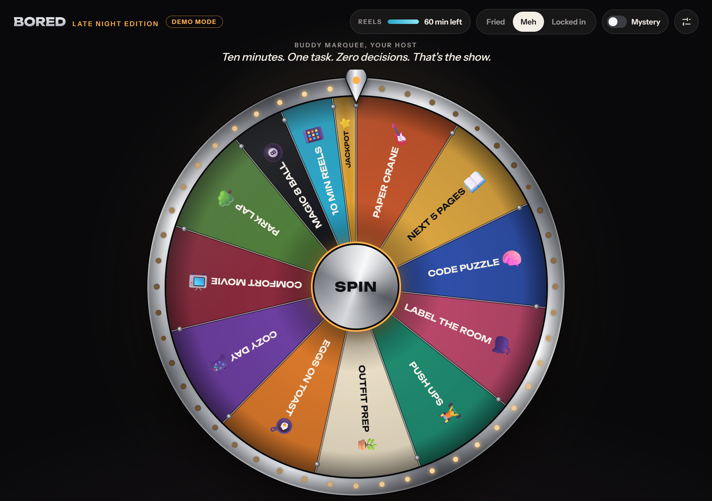

# Bored

A late night game show wheel that picks one small, specific thing to do when
you're bored. Spin it, get one ten minute task with zero decisions left, mark it
Done or Skip, and the wheel quietly learns what you actually finish.

Vanilla HTML, CSS, and JavaScript. No framework, no build step, no dependencies.



## What it does

- **One slice per category.** Each spin draws a task from every category that fits
  your mood (Fried, Meh, or Locked in), plus a thin, glowing jackpot slice.
- **A wheel with weight.** A canvas wheel that coasts down with a quintic ease out,
  a tick per slice, a pointer that bounces off the pegs, and the occasional near
  miss that stops on the jackpot and creeps one slice past.
- **No free respins.** A result stays on screen, even across reloads, until you
  mark it Done or Skip. A Start timer button counts the task down.
- **It learns.** Each Done raises a task's weight and each Skip lowers it, within a
  floor and a ceiling. Ten skips in a row benches a task until you unbench it.
  Categories you've neglected for a few days get bigger slices.
- **Guardrails for doomscrolling.** A daily reels budget drains with every reels
  win. When it's empty, the reels slice turns into a penalty.
- **Respects your settings.** Reduced motion shortens the spin and skips the near
  miss. The layout works from phone to desktop.

## Architecture

The app is split across two repositories.

| | `bored` (this repo, public) | `bored-data` (private) |
| --- | --- | --- |
| Holds | The engine: HTML, CSS, JS, example data | Real tasks, profile, history, generated ideas |
| Served by | GitHub Pages | Nobody. Read through the GitHub API |
| Written by | Me | The app (history) and a weekly job (ideas) |

**Why split it?** The tasks, history, and profile describe a real person's habits,
gear, and neighbourhood. None of that belongs in a public portfolio repo, but the
engine does. Keeping data out of the engine also means anyone can fork the engine
and point it at their own data without touching code.

**How the engine finds the data.** With no token saved, the app runs in demo mode on
`tasks.example.js` and keeps history only in the browser. Paste a fine grained token
into the drawer and it loads `tasks.json` and `ideas.json` from the data repo through
the GitHub Contents API, then writes every Done and Skip back to `history.json`.
The last good copy is cached, so it still works offline.

**Data is treated as data.** Files from the data repo are parsed with `JSON.parse`,
validated field by field, and copied before use. Task text is only ever rendered
with `textContent` or drawn on the canvas, never as HTML, and the page's Content
Security Policy blocks inline scripts. See [SECURITY.md](SECURITY.md).

```
bored (public, GitHub Pages)                 bored-data (private)
┌────────────────────────────┐   token   ┌──────────────────────────┐
│ index.html, app.js, …      │──────────▶│ tasks.json   (read)      │
│ tasks.example.js (demo)    │   GitHub  │ ideas.json   (read)      │
│ scripts/forge-report.mjs   │  Contents │ history.json (read/write)│
└────────────────────────────┘    API    └──────────────────────────┘
```

### Files

| File | Role |
| --- | --- |
| `index.html`, `styles.css` | The stage, the drawer, and the result card |
| `app.js` | Wheel drawing, spinning, results, learning, benching, the drawer |
| `data.js` | Picks demo or private data, validates it, and caches it |
| `github.js` | A small GitHub Contents API client. The token only ever goes in a header |
| `history.js` | The local log, skip streaks, and history sync |
| `ideas.js` | Merges `ideas.json` (new tasks and rewrites of benched ones) into the task list |
| `storage.js`, `sounds.js`, `confetti.js` | localStorage, synthesized Web Audio, hand rolled canvas confetti |
| `tasks.example.js`, `profile.example.js` | Example data, in the same shape a data repo uses |
| `scripts/forge-report.mjs` | Summarizes a data folder: benched tasks, finish rates, invalid ideas |

## Run it locally

Double click `index.html`. It runs straight from disk in demo mode, and with a token
saved it loads your data repo from there too.

To serve it the way GitHub Pages does, run a local server instead:

```sh
python -m http.server 8000
```

Then open <http://localhost:8000>.

## Use it with your own data

1. **Fork this repo** and turn on GitHub Pages (Settings, Pages, deploy from `main`, root).
2. **Create a private repo** for your data with three files:
   - `tasks.json`: copy the object from `tasks.example.js` and make it yours.
   - `ideas.json`: `{ "added": [], "rewrites": {} }`
   - `history.json`: `[]`
3. **Create a fine grained token** limited to that one private repo, with
   **Contents: Read and write** and nothing else.
4. **Open the app**, open the drawer, enter your repo as `owner/name`, paste the
   token, and save. The Demo mode badge disappears once your tasks load.

Optionally, run `node scripts/forge-report.mjs path/to/your-data-repo` to see which
tasks are benched and how each category is doing, then add new tasks or smaller
rewrites to `ideas.json`.

## Security

Tokens, the Content Security Policy, and the shared `github.io` origin are covered in
[SECURITY.md](SECURITY.md).
